# Chiikawa Rice

A light, bouncy [niri](https://github.com/YaLTeR/niri) +
[Noctalia Shell](https://github.com/noctalia-dev/noctalia-shell) rice with
Chiikawa, Hachiware, Usagi and Momonga living on your desktop.

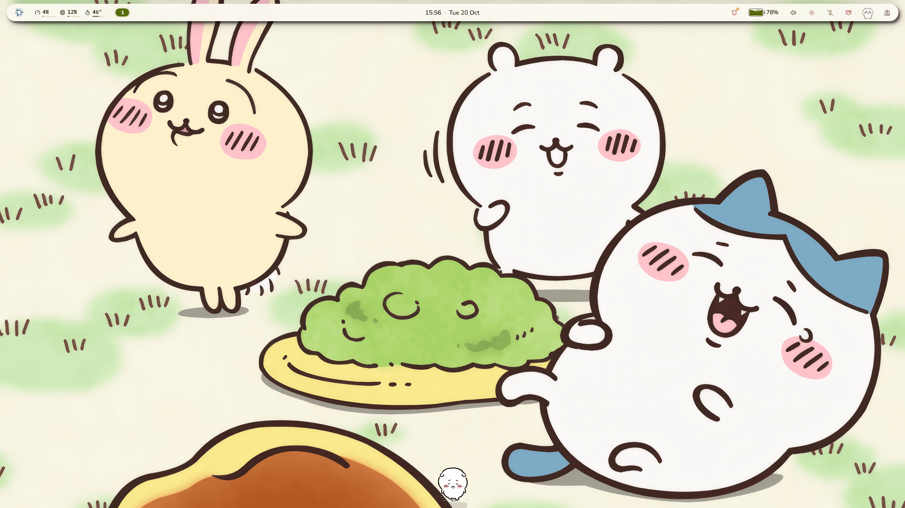

| | |
| --- | --- |
| 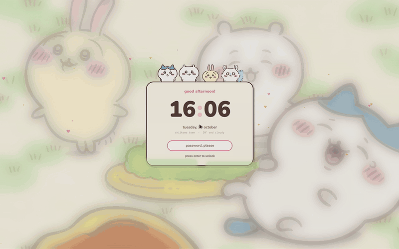 | 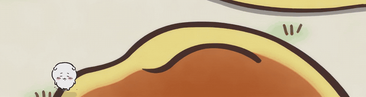 |
| 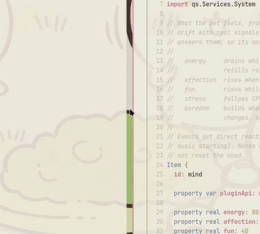 | 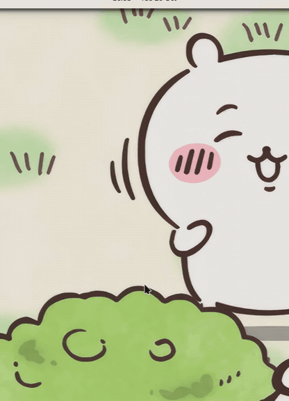 |
| 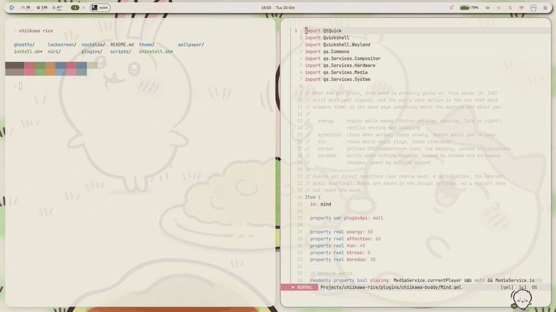 | 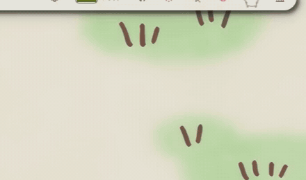 |

<details>
<summary>More screenshots</summary>

| | | |
| --- | --- | --- |
| 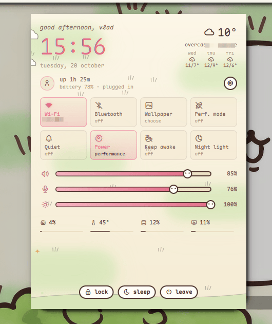 | 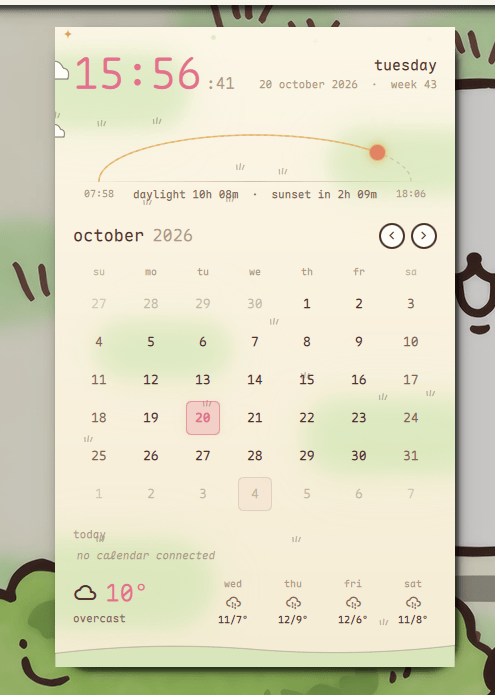 | 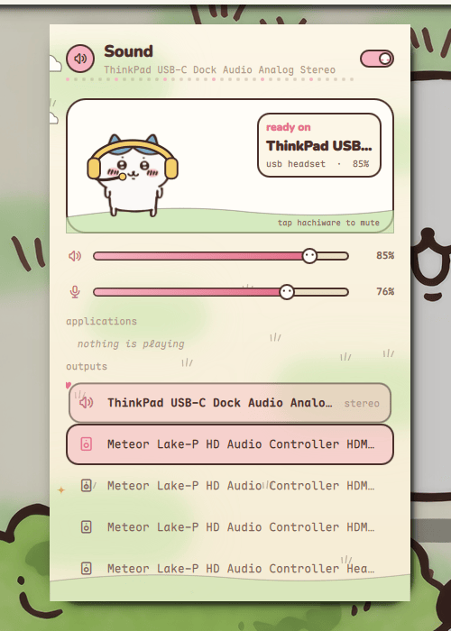 |
| 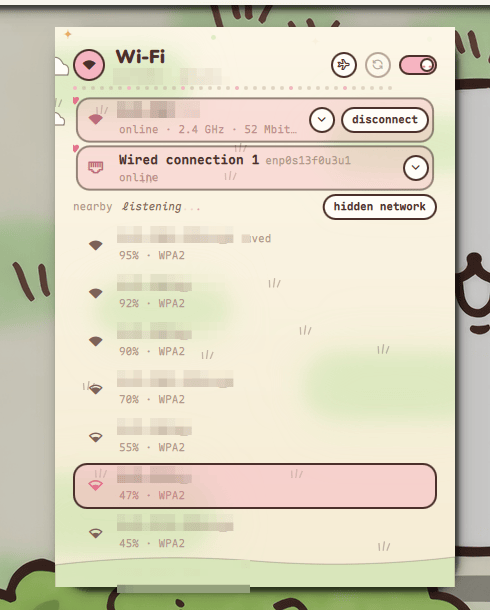 | 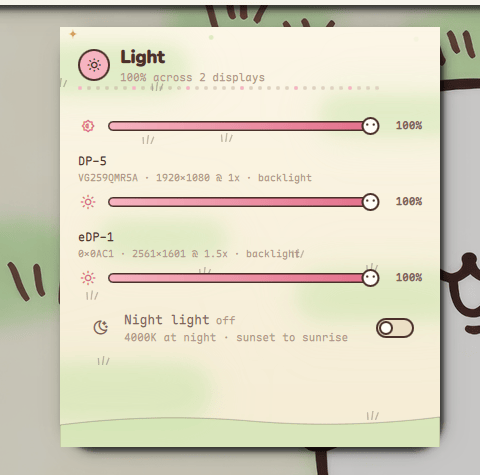 | 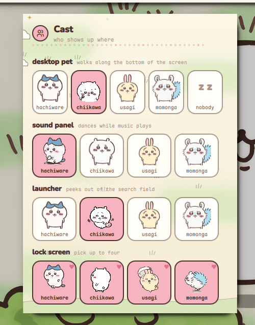 |
| 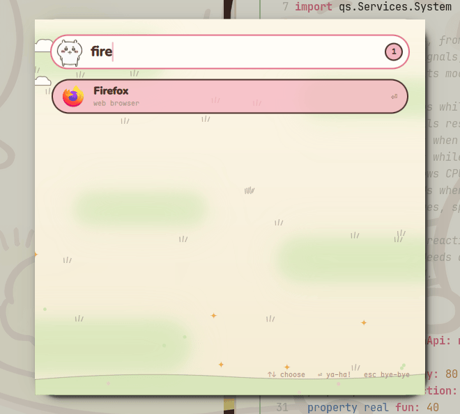 | 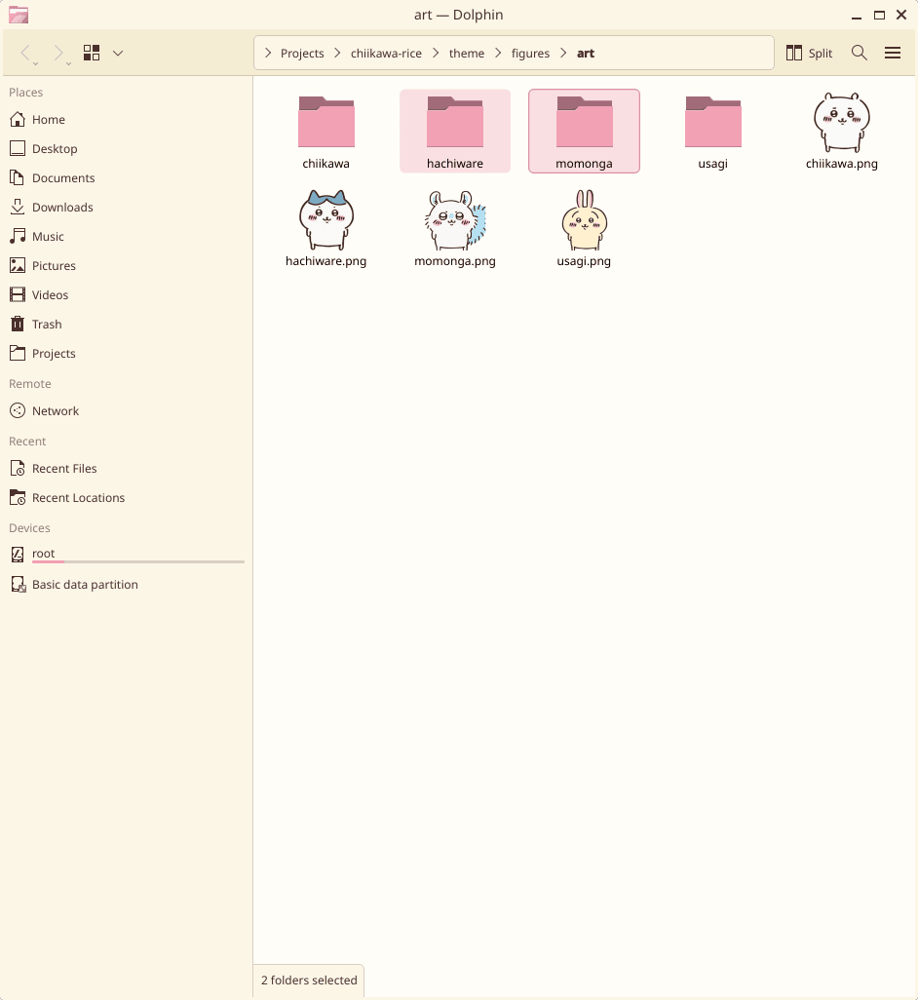 | 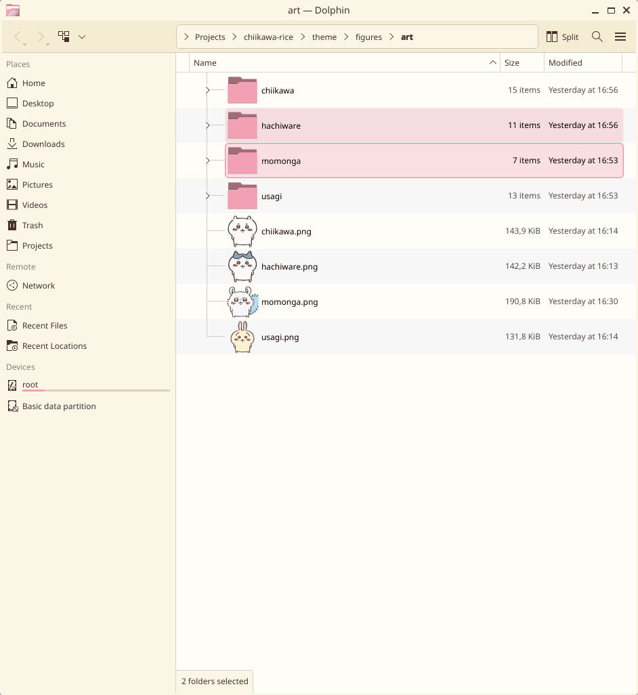 |

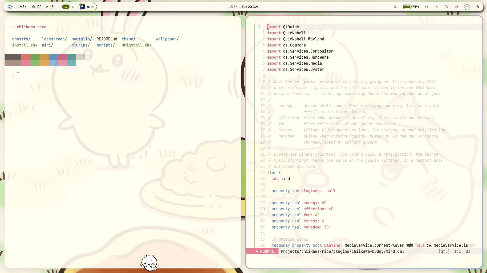
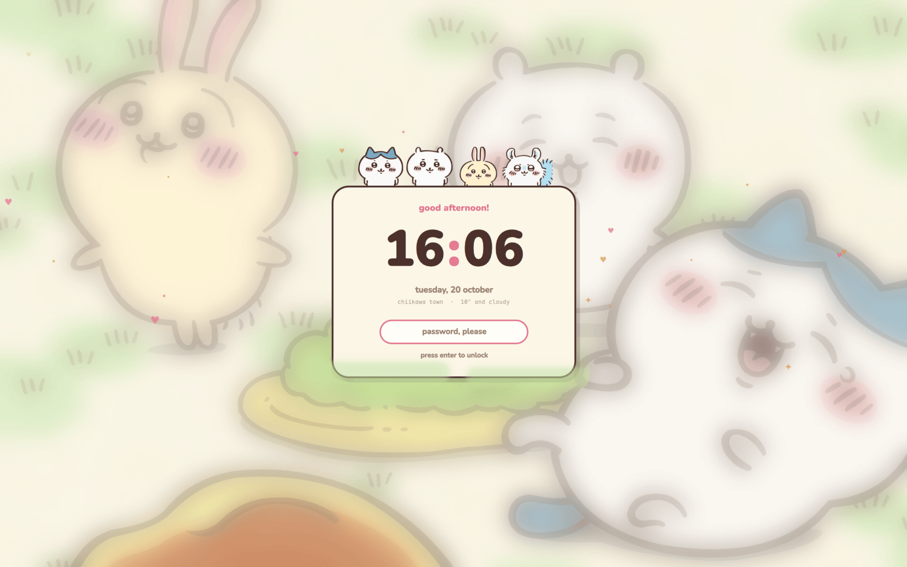

</details>

## Features

- Cream-paper wallpaper, light palette, a floating bar, and re-skinned
  panels for sound, brightness, Wi-Fi, Bluetooth, notifications, the
  calendar and the control center
- A desktop pet that wanders, naps, dances to music and reacts to your
  machine. Click it to pet it, drag it around, or right-click to swap friends.
- A launcher (`Mod+Space`) where Hachiware reacts as you type
- A lock screen (`Mod+Alt+L`) where the friends peek over a paper card
- A cast picker in the bar to choose who shows up where
- niri: round corners, a blush-to-blue focus ring and springy animations
- Matching Ghostty and Dolphin colors

## Requirements

- niri 25.11+ and Noctalia Shell 4.0+ (started at least once)
- `jq`, ImageMagick 7, `flock`
- Fonts: Nunito and Maple Mono NF
- Optional: Ghostty, Dolphin

## Install

```bash
git clone https://github.com/vladi245/chiikawa-rice ~/chiikawa-rice
cd ~/chiikawa-rice
./install.sh
```

The installer links everything from the clone, so keep it where it is and
`git pull` to update. It backs up your Noctalia, niri, Ghostty and Dolphin
settings to `~/.local/state/chiikawa-rice/` first, and `./uninstall.sh`
puts them back.

Preview the lock screen without locking:

```bash
WOODLAND_LOCK_PREVIEW=1 ./scripts/lock-screen
```

## Customizing

- Colors: `theme/Woodland.qml` (panels), `niri/chiikawa.kdl`,
  `ghostty/chiikawa.ghostty`, `kde/Chiikawa.colors`
- Animations: drop a gif into `theme/figures/art/<friend>/` and add its name
  to `theme/figures/cast.js`

## Credits

Chiikawa and its characters are by Nagano (ナガノ). The art in
`theme/figures/art/` and the wallpaper belong to Nagano / Chiikawa Committee.
This is an unofficial fan project; if you're a rights holder and want
something removed, please open an issue.
