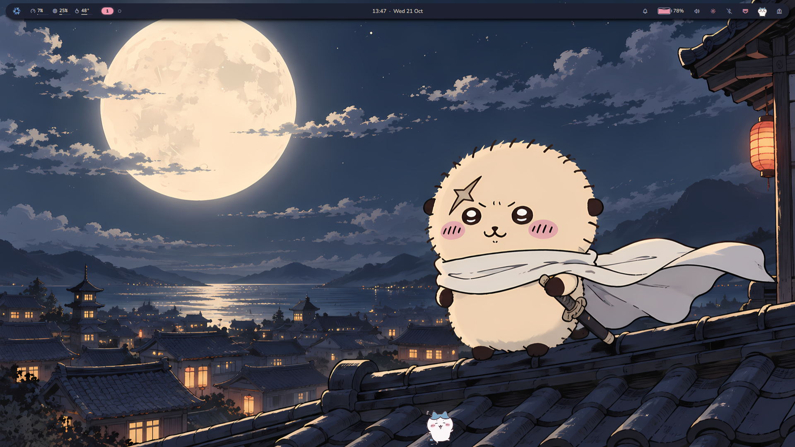
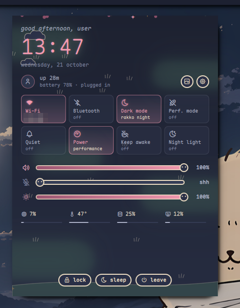
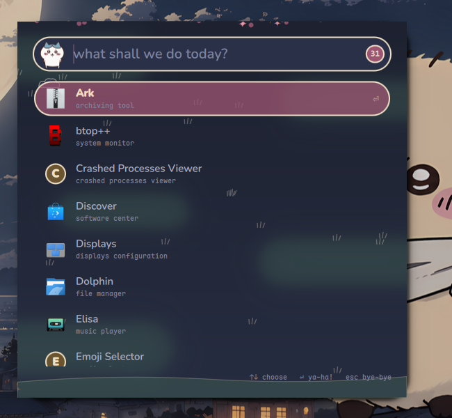
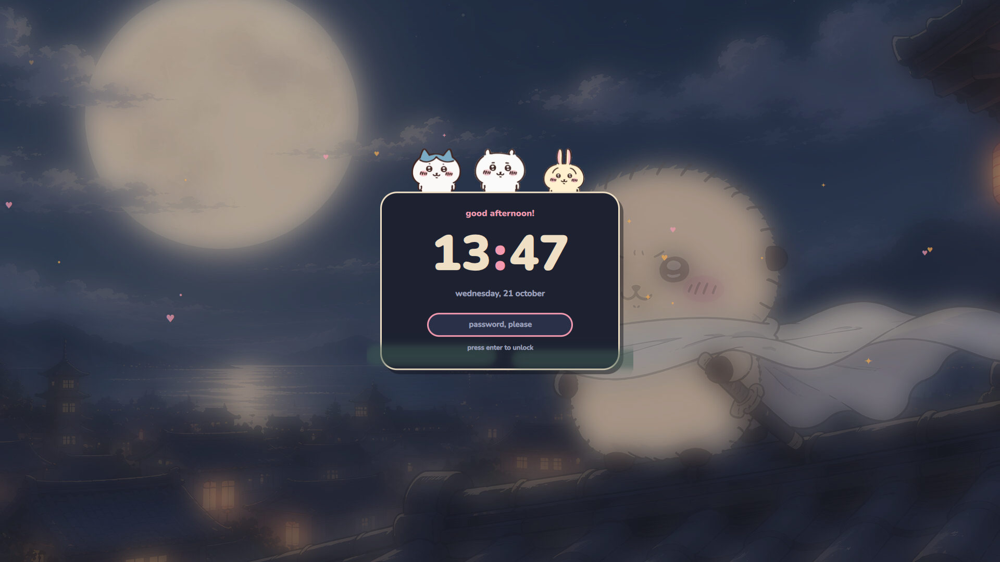

# Chiikawa Rice

A light, bouncy [niri](https://github.com/YaLTeR/niri) +
[Noctalia Shell](https://github.com/noctalia-dev/noctalia-shell) rice with
Chiikawa, Hachiware, Usagi and Momonga living on your desktop.

| Light | Dark |
| --- | --- |
|  |  |

| | |
| --- | --- |
|  |  |
|  |  |
|  |  |

<details>
<summary>More screenshots</summary>

| Light | Dark |
| --- | --- |
|  |  |
|  |  |
|  |  |

| | | |
| --- | --- | --- |
|  |  |  |
|  |  |  |


</details>

## Features

- Cream-paper wallpaper, light palette, a floating bar, and re-skinned
  panels for sound, brightness, Wi-Fi, Bluetooth, notifications, the
  calendar and the control center
- A desktop pet that wanders, naps, dances to music and reacts to your
  machine. Click it to pet it, drag it around, or right-click to swap friends.
- A launcher (`Mod+Space`) where Hachiware reacts as you type
- A lock screen (`Mod+Alt+L`) where the friends peek over a paper card
- A cast picker in the bar to choose who shows up where
- niri: round corners, a blush-to-blue focus ring and springy animations
- Matching Ghostty and Dolphin colors, and a Momonga fastfetch
  (`fastfetch -c chiikawa`)
- A dark mode with a moonlit Rakko wallpaper: the control center's
  "Dark mode" tile (or `noctalia-shell ipc call darkMode toggle`) switches
  the panels, wallpaper, niri, Ghostty, Dolphin and the lock screen

## Requirements

- niri 25.11+ and Noctalia Shell 4.0+ (started at least once)
- `jq`, ImageMagick (6 or 7), `flock` (util-linux)
- Fonts: [Nunito](https://fonts.google.com/specimen/Nunito) and
  [Maple Mono NF](https://github.com/subframe7536/maple-font)
- Optional: Ghostty, Dolphin, fastfetch

The installer is a plain shell script, so any distro with these works.
Noctalia has [install instructions](https://github.com/noctalia-dev/noctalia-shell)
for most distros. On Arch the rest is:

```bash
sudo pacman -S niri jq imagemagick util-linux
```

On NixOS, with Noctalia's flake as an input (`github:noctalia-dev/noctalia-shell`):

```nix
programs.niri.enable = true;
environment.systemPackages = with pkgs; [
  inputs.noctalia.packages.${pkgs.system}.default
  jq imagemagick util-linux
];
fonts.packages = with pkgs; [ nunito maple-mono.NF ];
```

## Try it first

```bash
./scripts/preview
```

From a clone (see Install), this opens the rice in a nested niri window with
its own throwaway home, so your niri, Noctalia and dotfiles are left alone.
Close it with `Alt+Shift+E`.

<details>
<summary>Preview keys and options</summary>

Inside the window `Alt` is Mod:

| Keys | Does |
| --- | --- |
| `Alt+Space` | Launcher |
| `Alt+O` | Overview |
| `Alt+Return` | Terminal |
| `Alt+Shift+D` | Toggle dark mode |
| `Alt+Shift+/` | All keys |
| `Alt+Shift+E` | Close the preview |

- `./scripts/preview --reset` starts over from a fresh home
- The preview lives in `~/.local/state/chiikawa-rice/preview`
- `CHIIKAWA_LOCK_PREVIEW=1 ./scripts/lock-screen` previews just the lock
  screen, without locking

</details>

## Install

```bash
git clone https://github.com/vladi245/chiikawa-rice ~/chiikawa-rice
cd ~/chiikawa-rice
./install.sh
```

The installer links everything from the clone, so keep it where it is and
`git pull` to update. It backs up your Noctalia, niri, Ghostty and Dolphin
settings to `~/.local/state/chiikawa-rice/` first, and `./uninstall.sh`
puts them back.

## Customizing

- Colors: `theme/Theme.qml` (panels, both modes), `niri/chiikawa.kdl` and
  `niri/dark.kdl`, `ghostty/themes/`, `kde/Chiikawa.colors` and
  `kde/ChiikawaNight.colors`
- Dark mode runs `scripts/chiikawa-mode` through Noctalia's dark mode hook
  for niri and Dolphin. Ghostty follows the desktop's light/dark preference,
  which Noctalia sets when "sync gsettings" is on.
- Animations: drop a gif into `theme/figures/art/<friend>/` and add its name
  to `theme/figures/cast.js`

## Credits

Chiikawa and its characters are by Nagano (ナガノ). The art in
`theme/figures/art/` and the wallpaper belong to Nagano / Chiikawa Committee.
This is an unofficial fan project; if you're a rights holder and want
something removed, please open an issue.
